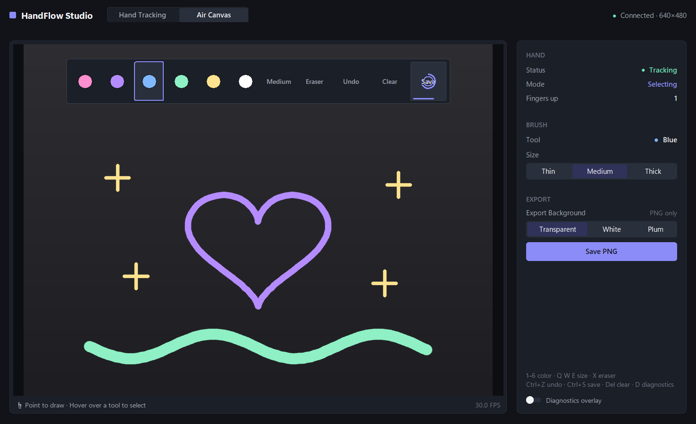
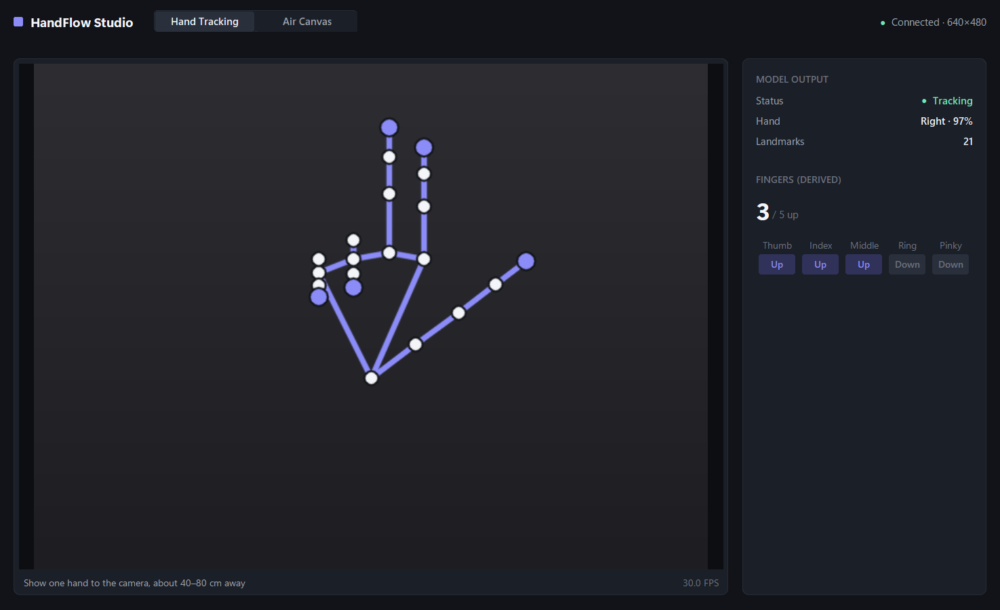

# HandFlow Studio — Hand Tracking & Air Canvas

**English** · [Türkçe](README.md)

HandFlow Studio is a desktop computer-vision app. It tracks your hand through a
webcam, counts raised fingers, and lets you **draw in the air** with your index
finger. It is built with **OpenCV**, the **MediaPipe Hand Landmarker (Tasks
API)** and **CustomTkinter**, with a minimal dark interface.

> **Status:** Hand Tracking and Air Canvas are implemented and covered by an
> automated test suite that uses synthetic hands and mock camera data.
> Behaviour with a physical hand and webcam must still be checked manually;
> see *Known limitations*.

| Air Canvas | Hand Tracking |
|---|---|
|  |  |

<sub>Screenshots of the real UI, rendered from **synthetic data**, not a webcam:
the "camera" is a plain grey frame, the hand is a synthetic skeleton, the strokes
were drawn programmatically, and the status values (including "Connected" and
30 FPS) come from mock snapshots. Regenerate them with
`python -m tools.make_screenshots` (Windows; the window stays invisible and
never takes focus).</sub>

## Interface

| Area | Contents |
|---|---|
| **Header** | HandFlow Studio · mode switch (Hand Tracking / Air Canvas) · camera status |
| **Workspace** | Camera preview (mirrored, aspect ratio kept). Hand Tracking: landmarks and skeleton. Air Canvas: drawing, fingertip cursor and the **virtual toolbar**. Footer: short instruction and FPS. |
| **Inspector** | Hand Tracking: model output (status, handedness, landmarks) and derived finger states. Air Canvas: hand status and mode, brush (color and size), export (background, Save PNG), keyboard shortcuts, and an optional diagnostics overlay (off by default). |

The virtual toolbar is the single place for colors, size cycling, Eraser, Undo,
Clear and Save, for both the hand and the mouse; the inspector doesn't repeat
those buttons. Accent color (#8B8CF8) is used only for selection, focus and dwell
progress; yellow marks a Clear that is waiting for confirmation.

## Features

### Hand Tracking mode (Stage 1)
- Live webcam preview, mirrored like a selfie camera, with the aspect ratio kept.
- Camera status: connecting, connected (with resolution), unavailable, or lost and reconnecting.
- MediaPipe Hand Landmarker in **VIDEO mode** with strictly increasing timestamps.
- 21 landmarks and the official skeleton connections.
- Left/right handedness, from the user's point of view, with the model's confidence.
- Per-finger state, **Up** / **Down** / **?** (uncertain), and a total count from 0 to 5.
- Live FPS. The UI keeps model output separate from derived measurements.

### Air Canvas mode (Stage 2)
- Draw with your **index finger**. Strokes persist until you undo or clear them.
- Six brushes: **Pink, Purple, Blue, Mint, Yellow, White**.
- Three sizes: **Thin, Medium, Thick**.
- **Eraser**, **Undo** (last 50 actions), **Clear** (two-step confirmation, and undoable).
- **Save PNG**: exports only the drawing, never camera pixels. The background
  can be transparent, white or dark.
- **One-finger control**: the raised index finger draws on the canvas, and
  selects a tool when it rests on the toolbar over the preview. A progress ring
  around the fingertip shows the dwell.
- The virtual toolbar is also clickable with the mouse. **Mouse drawing** and
  **keyboard shortcuts** work too, even without a camera (on a blank canvas).
- The inspector shows hand status, the current mode (Drawing / Selecting / …),
  finger count, the active color or eraser, the brush size picker and the
  export controls.

## Project structure

```
handflow/
├── main.py                 # Entry point, wiring and clean shutdown
├── config.py               # Paths, camera/tracking/canvas settings, theme colors
├── core/                   # No UI toolkit in here
│   ├── camera.py           # OpenCV webcam open/read/release
│   ├── hand_tracker.py     # MediaPipe Hand Landmarker (VIDEO mode)
│   ├── finger_counter.py   # Geometric finger analysis (NumPy only)
│   ├── processing.py       # Worker thread: camera → tracker → counter → snapshots
│   ├── overlay.py          # Draws landmarks and skeleton onto frames
│   ├── gestures.py         # Finger states → DRAW / SELECT / IDLE / UNKNOWN + debouncing
│   ├── air_canvas.py       # Controller: gestures → strokes and toolbar commands
│   ├── canvas.py           # Vector stroke model, eraser, bounded undo history
│   ├── smoothing.py        # One Euro filter for the fingertip pointer
│   ├── canvas_render.py    # Stroke rasterizing, compositing, PNG export
│   └── viewport.py         # Normalized ↔ on-screen coordinates (letterboxing)
├── ui/
│   ├── app.py              # Window, header, workspace, virtual toolbar, input
│   ├── canvas_panel.py     # Air Canvas inspector
│   └── theme.py            # Design tokens: spacing, radii, type scale, fonts
├── tools/
│   ├── make_screenshots.py # README screenshots from synthetic data
│   └── offscreen_capture.py# Invisible, non-activating window capture (Windows)
├── models/                 # Official MediaPipe model, source/checksum notes, Apache-2.0 text
├── docs/screenshots/
├── tests/                  # pytest suite (synthetic landmarks, mock snapshots)
└── output/                 # Created on first save (ignored by git)
```

## Installation

Tested on **Windows 11** with **Python 3.13.2**.

```powershell
cd handflow
py -3.13 -m venv .venv
.venv\Scripts\activate
python -m pip install --upgrade pip
pip install -r requirements.txt
```

The model file `models/hand_landmarker.task` is included. Its source and
SHA-256 checksum are documented in [`models/README.md`](models/README.md), and
the app checks the checksum at startup.

> `requirements.txt` lists `opencv-contrib-python` rather than `opencv-python`:
> MediaPipe depends on the contrib build, which provides the same `cv2` module.
> Installing both packages makes them overwrite each other.

## Launch

```powershell
.venv\Scripts\activate
python main.py
```

Run the tests with `python -m pytest`. UI tests use an invisible, click-through,
non-activating window, so they don't interrupt your desktop.

## Usage

### Hand Tracking
Hold one hand in front of the camera, about 40–80 cm away, in good light. The
skeleton, finger states, count, handedness and FPS update live.

### Air Canvas
Click **Air Canvas** in the header (or press **F2**).

**☝ Point to draw · Hover over a tool to select.** One raised index finger
does both. What it does depends on **where** the fingertip is:

| Fingertip in… | Index finger raised | Fist / no hand / unclear |
|---|---|---|
| **Toolbar** (top strip) | Hover. Rest on an item to select it. Never draws. | Nothing. Hover is cancelled. |
| **Buffer** (thin strip under the toolbar) | Nothing. No new stroke starts here. | Pen up |
| **Canvas** (everything below) | **Draw** | Pen up |

- **Colors, Size, Eraser** are selected after resting **0.5 s** on them.
- **Undo, Clear, Save** need **1.0 s**, so they don't fire by accident.
- The dwell only advances while the finger is nearly still. Sweeping across
  the toolbar selects nothing.
- Entering the toolbar ends the current stroke. Coming back down starts a
  **new** stroke below the buffer, so no line connects the two.
- Index + middle (the Stage 2 "select" gesture) still works over the toolbar,
  but it isn't needed. On the canvas it moves the pointer without drawing.

Gestures are defined by the **four long fingers**; the thumb may be folded or
relaxed. If one of those four fingers is uncertain, the frame is ignored. A few
uncertain frames (up to 0.35 s) only *pause* the pen or the dwell timer; they
never add dwell time.

**Toolbar** (top of the preview): six colors · **Size** (cycles Thin → Medium →
Thick) · **Eraser** (on/off) · **Undo** · **Clear** · **Save**.

- The dwell timer pauses (doesn't restart) on brief misses up to 0.3 s, and the
  hovered item keeps a slightly larger hit box, so fingertip jitter on its edge
  doesn't restart the timer or jump to the neighbouring item.
- After a tool fires, it stays "latched" until the pointer leaves it, so holding
  the gesture never repeats an action (for example, Save). There is a 0.6 s
  cooldown between commands, and 2 s extra after Save or Clear.
- **Clear** is a two-step action: **hold to confirm**. Resting on Clear for 1 s
  arms it (it turns yellow, "Confirm?"). Keep resting there and a **yellow**
  ring fills again; after one more second the canvas is cleared. You never
  have to move onto the neighbouring Undo/Save to confirm. If you leave
  instead, nothing is cleared. Clear is undoable. With the mouse or keyboard,
  click or press it twice.
- The toolbar strip is never drawn on. Losing the hand ends the stroke
  immediately.
- **Reaching the toolbar:** the toolbar keeps 10 % away from the left and right
  image edges and 5 % from the top. Pointing at a button close to the edge used
  to push part of the hand out of the camera image, which makes MediaPipe jitter
  or briefly lose the hand. Undo, Clear and Save are the widest buttons.
- **Tracking drop-outs:** if the hand vanishes for a frame or two (typical near
  the edges), a toolbar hover only *pauses* (up to 0.3 s) and the gesture
  continues without re-confirming. A longer absence cancels the hover. While
  drawing, the pen still lifts at once and no line bridges the gap.
- While the fingertip is over the toolbar it is smoothed more strongly (steadier
  cursor); on the canvas the low-latency setting is used.

**Keyboard** (in Air Canvas mode): `1`–`6` colors · `Q` / `W` / `E` thin / medium / thick ·
`X` eraser · `Ctrl+Z` undo · `Ctrl+S` save · `Del` clear (press twice) ·
`D` diagnostics · `F1` / `F2` switch mode.

**Diagnostics** (off by default): turn on **Diagnostics overlay** at the bottom
of the inspector, or press `D`. A small panel on the preview shows the raw and stable gesture,
the reason a frame was rejected (for example `uncertain: Middle`), the raw and
filtered fingertip, its mapped pixel position, the hovered item, the dwell
progress, and how often each gesture was seen over the last 3 s. If gestures
feel unreliable, this panel shows why.

**Mouse**: drag on the preview to draw, and click a toolbar item to use it.
The inspector has a brush-size picker and the Save PNG button (disabled while
the canvas is empty).

**Export Background** (inspector): *Transparent*, *White* or *Dark* (the app's
background color, #111318). This only sets the background of saved PNG files.
It never changes the brush color.

**Saving**: files go to `output/handflow_YYYYMMDD_HHMMSS.png` inside the project
folder, and existing files are never overwritten. The image is 1600 px on its
long side and follows the camera's aspect ratio. Only strokes are exported, on
the background chosen under *Export Background*.

## How it works

### Finger counting
`core/finger_counter.py` uses MediaPipe's metric 3D **world landmarks**, so the
result does not depend on how the hand is rotated in the image.
- **Index to pinky:** the bend at the PIP and DIP joints, plus whether the
  fingertip is farther from the wrist than the PIP joint.
- **Thumb:** the bend at the MCP and IP joints, plus whether the thumb tip is
  farther from the pinky knuckle than the IP joint.
- If these cues disagree, the finger is marked **uncertain** instead of guessed.
- **Over time** (`FingerTracker`): live landmarks are slightly noisy, and noise
  always makes a finger look *more* bent. Judging every frame on its own made
  an open hand flicker between 3, 4 and 5. The tracker therefore smooths the
  landmarks lightly and adds per-finger hysteresis: a finger that is Up stays Up
  until it is clearly bent, and vice versa. It resets as soon as the hand is
  lost. In a simulation with MediaPipe-like noise, a relaxed open hand went from
  being read as 5 in ~4% of frames to ~99%, fists stayed at 100%, and opening or
  closing the hand still shows within about 1–5 frames.
- The thumb's reach threshold is 1.05: a relaxed open thumb measures ~1.09,
  while folded thumbs in a fist measure 0.72–0.82.

### From tracking to drawing
1. The worker thread mirrors each frame **before** detection. The landmarks are
   therefore already in the coordinates of the image you see.
2. Each result is an immutable `FrameSnapshot` with a sequence number and a
   timestamp. The UI processes every new snapshot exactly once, in order.
3. `gestures.explain_gesture` maps the index/middle/ring/pinky states to a
   gesture, with a rejection reason. `GestureStabilizer` switches gesture after
   it has held for 0.12 s (0.18 s for SELECT, 0.35 s for UNKNOWN). Losing the
   hand lifts the pen immediately.
4. `AirCanvasController` uses the index fingertip (landmark 8), smoothed with a
   **One Euro filter** (`core/smoothing.py`): strong smoothing when the finger
   is still, little lag when it moves. The frames that confirm DRAW are drawn
   too, so a stroke starts where the gesture started. During brief uncertainty
   the pen pauses, and it continues the stroke only if the fingertip moved less
   than 5% of the frame. A **new stroke** starts after a gap of more than 0.5 s
   or a jump of more than 15% of the frame, so there are no long accidental
   lines when tracking is lost and recovered.
5. Strokes are stored in **normalized coordinates** (0–1 of the camera frame),
   and thickness as a fraction of the frame height. On every repaint they are
   drawn at the current preview size. `viewport.fit_viewport` computes the
   letterboxed image area, so resizing never distorts the drawing and mouse
   clicks map correctly.
6. The stroke being drawn is updated with only its new segments each frame, so
   the cost per frame does not grow with the length of a continuous line. When
   the stroke is finished it is rendered in full again; saved drawings and PNG
   exports are not affected.

## Known limitations

- **Real-hand validation:** gestures, dwell timing, stroke breaking, coordinate
  mapping, rendering and export are covered by automated tests that use
  synthetic landmarks, mock snapshots and simulated tk mouse/keyboard events.
  Drawing with a physical hand still needs manual testing. The rule thresholds
  (`config.py`) may need tuning for different hands, cameras and lighting. Use
  the diagnostics panel to see what is being rejected before changing them.
- Gestures are rule-based on finger geometry. A loosely curled finger can be
  *uncertain* and is then ignored, which is a deliberate choice: no stroke is
  started from an unreliable reading.
- One hand is tracked (`config.MAX_HANDS = 1`).
- Accuracy drops with occlusion, an edge-on hand, motion blur or poor lighting.
  MediaPipe still predicts hidden joints, so a hidden finger can be misjudged.
- Strokes are tied to the camera frame's aspect ratio. If the camera resolution
  changes to a different aspect ratio mid-session, existing strokes are
  stretched to match.
- The drawing lives in memory only. It is lost on exit unless you save it, and
  saved PNGs cannot be reopened for editing.
- At most 2000 strokes are kept, and only the last 50 actions can be undone.
- OpenCV cannot tell apart a missing camera, a camera in use by another app,
  and a camera blocked by privacy settings.
- The screenshot tool in `tools/` works on Windows only.

## License

- **HandFlow source code:** no license has been chosen yet. Until a `LICENSE`
  file is added, others have no explicit permission to reuse the code. Pick a
  license (for example MIT or Apache-2.0) before publishing.
- **Bundled model** `models/hand_landmarker.task`: Apache License 2.0 according
  to Google's official model card; the license text is in
  [`models/LICENSE-Apache-2.0.txt`](models/LICENSE-Apache-2.0.txt). Details and
  caveats: [`models/README.md`](models/README.md).
- **Dependencies** (installed with pip, not included in this repository), as
  reported by their package metadata: MediaPipe and OpenCV — Apache 2.0;
  Pillow — MIT-CMU; NumPy — BSD-3-Clause (with bundled components under other
  permissive licenses); pytest — MIT; CustomTkinter — its metadata states
  "Creative Commons Zero v1.0 Universal" in the license field and an MIT
  classifier, so check the project itself if this matters to you.

This section is a summary, not legal advice.

## Privacy

Camera frames are processed in memory and never recorded, saved or uploaded.
PNG exports contain only the strokes you drew.
