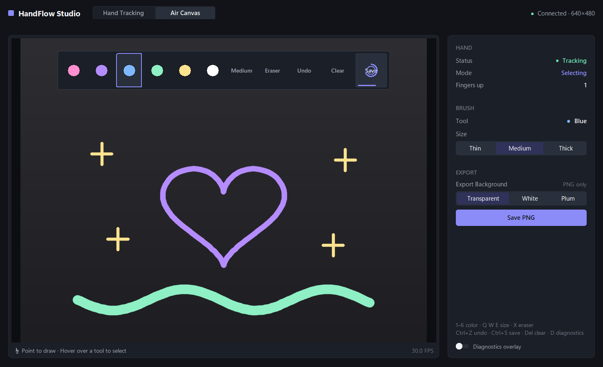
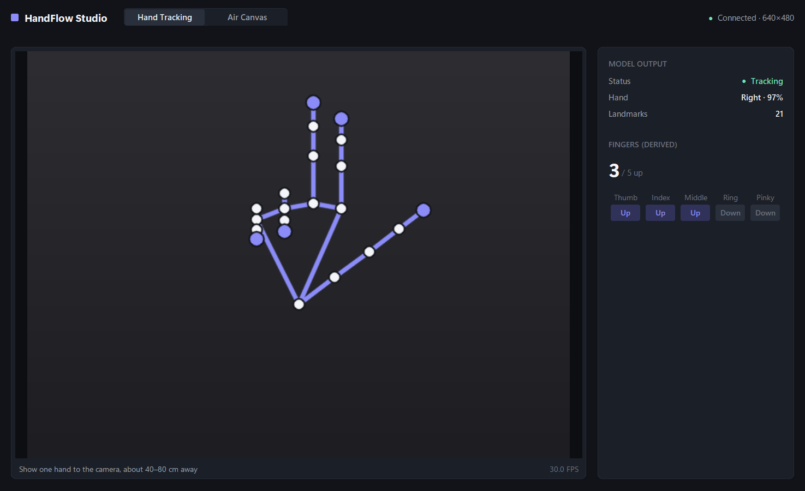

# HandFlow Studio — El Takibi ve Havada Çizim

[English](README.en.md) · **Türkçe**

HandFlow Studio bir masaüstü bilgisayarlı görü uygulamasıdır. Elinizi webcam
üzerinden takip eder, kalkık parmakları sayar ve işaret parmağınızla **havada
çizim** yapmanızı sağlar. **OpenCV**, **MediaPipe Hand Landmarker (Tasks API)** ve
**CustomTkinter** ile yazılmıştır; sade, koyu bir arayüzü vardır.

> **Durum:** El Takibi (Hand Tracking) ve Havada Çizim (Air Canvas) modları
> hazır. Sentetik el ve sahte kamera verisi kullanan otomatik testlerle
> kontrol ediliyor. Gerçek el ve webcam ile davranış ayrıca elle denenmelidir;
> bkz. *Bilinen sınırlamalar*.

| Air Canvas | Hand Tracking |
|---|---|
|  |  |

<sub>Ekran görüntüleri gerçek arayüzden alındı, ancak webcam yerine **sentetik
veriyle** üretildi: "kamera" düz gri bir kare, el sentetik bir iskelet, çizgiler
kodla çizildi. "Connected" ve 30 FPS gibi durum değerleri sahte verilerden
geliyor. Yeniden üretmek için: `python -m tools.make_screenshots` (yalnızca
Windows; pencere görünmez kalır ve odağı hiç almaz).</sub>

## Arayüz

| Alan | İçerik |
|---|---|
| **Başlık** | HandFlow Studio · mod anahtarı (Hand Tracking / Air Canvas) · kamera durumu |
| **Çalışma alanı** | Kamera önizlemesi (aynalanmış, en-boy oranı korunur). Hand Tracking: landmark'lar ve iskelet. Air Canvas: çizim, parmak ucu imleci ve **sanal araç çubuğu**. Alt şerit: kısa talimat ve FPS. |
| **Denetçi paneli** | Hand Tracking: model çıktısı (durum, sağ/sol el, landmark sayısı) ve türetilen parmak durumları. Air Canvas: el durumu ve mod, fırça (renk ve kalınlık), dışa aktarma (arka plan, Save PNG), klavye kısayolları ve isteğe bağlı tanılama katmanı (varsayılan olarak kapalı). |

Renkler, kalınlık değiştirme, Eraser, Undo, Clear ve Save **yalnızca** sanal
araç çubuğundadır; hem el hem fare oradan kullanır, denetçi paneli bu düğmeleri
tekrar etmez. Vurgu rengi (#8B8CF8) yalnızca seçim, odak ve bekleme ilerlemesi
için kullanılır. Sarı, onay bekleyen bir Clear'ı gösterir.

## Özellikler

### Hand Tracking modu
- Canlı webcam önizlemesi: selfie kamerası gibi aynalanmış, en-boy oranı korunmuş.
- Kamera durumu: bağlanıyor, bağlı (çözünürlükle), kullanılamıyor, ya da bağlantı
  koptu ve yeniden bağlanıyor.
- MediaPipe Hand Landmarker **VIDEO modunda**, zaman damgaları her karede artar.
- 21 landmark ve resmî iskelet bağlantıları.
- Sağ/sol el bilgisi (kullanıcının bakış açısından) ve modelin güven değeri.
- Her parmak için durum (**Up** / **Down** / **?** belirsiz) ve 0–5 arası toplam.
- Canlı FPS. Arayüz, model çıktısını türetilen ölçümlerden ayrı gösterir.

### Air Canvas modu
- **İşaret parmağıyla çizim.** Çizgiler geri alınana ya da temizlenene kadar kalır.
- Altı renk: **Pink, Purple, Blue, Mint, Yellow, White**.
- Üç kalınlık: **Thin, Medium, Thick**.
- **Eraser**, **Undo** (son 50 işlem), **Clear** (iki adımlı onay, geri alınabilir).
- **Save PNG**: Yalnızca çizimi kaydeder, kamera görüntüsünü asla. Arka plan
  şeffaf, beyaz ya da koyu olabilir.
- **Tek parmakla kontrol**: Kalkık işaret parmağı tuvalde çizer; önizlemenin
  üstündeki araç çubuğunda durduğunda aracı seçer. Parmak ucunun etrafındaki
  halka bekleme süresini gösterir.
- Sanal araç çubuğuna fareyle de tıklanabilir. **Fareyle çizim** ve **klavye
  kısayolları** da çalışır, kamera olmadan bile (boş tuvalde).
- Denetçi paneli el durumunu, o anki modu (Drawing / Selecting / …), parmak
  sayısını, seçili rengi ya da silgiyi, kalınlık seçiciyi ve dışa aktarma
  ayarlarını gösterir.

## Proje yapısı

```
handflow/
├── main.py                 # Giriş noktası, bileşenleri bağlama ve temiz kapanış
├── config.py               # Yollar, kamera/takip/tuval ayarları, tema renkleri
├── core/                   # Arayüz kütüphanesi yok
│   ├── camera.py           # OpenCV ile webcam açma/okuma/kapatma
│   ├── hand_tracker.py     # MediaPipe Hand Landmarker (VIDEO modu)
│   ├── finger_counter.py   # Geometrik parmak analizi (yalnızca NumPy)
│   ├── processing.py       # Arka plan iş parçacığı: kamera → takip → sayım → snapshot
│   ├── overlay.py          # Landmark ve iskeleti kareye çizer
│   ├── gestures.py         # Parmak durumları → DRAW / SELECT / IDLE / UNKNOWN + kararlılık
│   ├── air_canvas.py       # Denetleyici: jestler → çizgiler ve araç komutları
│   ├── canvas.py           # Vektör çizgi modeli, silgi, sınırlı geri alma geçmişi
│   ├── smoothing.py        # Parmak ucu imleci için One Euro filtresi
│   ├── canvas_render.py    # Çizgileri raster'a çevirme, birleştirme, PNG dışa aktarma
│   └── viewport.py         # Normalleştirilmiş ↔ ekran koordinatları (kenar boşlukları)
├── ui/
│   ├── app.py              # Pencere, başlık, çalışma alanı, sanal araç çubuğu, girdi
│   ├── canvas_panel.py     # Air Canvas denetçi paneli
│   └── theme.py            # Tasarım ölçüleri: boşluk, köşe, yazı ölçeği, yazı tipleri
├── tools/
│   ├── make_screenshots.py # Sentetik veriyle README ekran görüntüleri
│   └── offscreen_capture.py# Görünmez, odak almayan pencere yakalama (Windows)
├── models/                 # Resmî MediaPipe modeli, kaynak/hash notları, Apache-2.0 metni
├── docs/screenshots/
├── tests/                  # pytest testleri (sentetik landmark'lar, sahte snapshot'lar)
└── output/                 # İlk kayıtta oluşturulur (git tarafından yok sayılır)
```

## Kurulum

**Windows 11** ve **Python 3.13.2** ile test edildi.

```powershell
cd handflow
py -3.13 -m venv .venv
.venv\Scripts\activate
python -m pip install --upgrade pip
pip install -r requirements.txt
```

Model dosyası `models/hand_landmarker.task` projeyle birlikte gelir. Kaynağı,
SHA-256 hash'i ve lisansı [`models/README.md`](models/README.md) dosyasında
yazılı; uygulama açılışta hash'i kontrol eder.

> `requirements.txt` içinde `opencv-python` değil `opencv-contrib-python` var:
> MediaPipe contrib sürümüne bağımlıdır ve bu sürüm aynı `cv2` modülünü sağlar.
> İkisini birlikte kurmak birbirinin dosyalarının üzerine yazar.

## Çalıştırma

```powershell
.venv\Scripts\activate
python main.py
```

Testleri çalıştırmak için: `python -m pytest`. Arayüz testleri görünmez, tıklamaları
geçiren ve odak almayan bir pencere kullanır; masaüstünüzü kesintiye uğratmaz.

## Kullanım

### Hand Tracking
Bir elinizi kameraya, yaklaşık 40–80 cm uzaklıkta ve iyi ışıkta gösterin.
İskelet, parmak durumları, sayı, sağ/sol el ve FPS canlı güncellenir.

### Air Canvas
Başlıktaki **Air Canvas**'a tıklayın (ya da **F2**'ye basın).

**☝ Çizmek için gösterin · Seçmek için bir aracın üzerinde durun.** Tek bir kalkık
işaret parmağı ikisini de yapar. Ne yapacağı parmak ucunun **nerede** olduğuna
bağlıdır:

| Parmak ucu… | İşaret parmağı kalkık | Yumruk / el yok / belirsiz |
|---|---|---|
| **Araç çubuğunda** (üst şerit) | Üzerinde durur; bir öğede beklerseniz seçer. Asla çizmez. | Hiçbir şey; üzerinde durma iptal olur. |
| **Tampon bölgede** (araç çubuğunun hemen altı) | Hiçbir şey; yeni çizgi burada başlamaz. | Kalem kalkar |
| **Tuvalde** (geri kalan her yer) | **Çizer** | Kalem kalkar |

- **Renkler, Size, Eraser** üzerlerinde **0,5 s** durunca seçilir.
- **Undo, Clear, Save** kazara çalışmasınlar diye **1,0 s** ister.
- Bekleme süresi yalnızca parmak neredeyse dururken ilerler; araç çubuğunun
  üzerinden hızla geçmek hiçbir şey seçmez.
- Araç çubuğuna girmek o anki çizgiyi bitirir. Aşağı geri dönünce tamponun
  altında **yeni** bir çizgi başlar; ikisini birleştiren bir çizgi oluşmaz.
- İşaret + orta parmak (eski "seçim" jesti) araç çubuğunda hâlâ çalışır ama
  gerekmez. Tuvalde ise imleci çizmeden hareket ettirir.

Jestler **dört uzun parmakla** tanımlanır; başparmak katlı ya da gevşek olabilir.
Bu dört parmaktan biri belirsizse o kare yok sayılır. Birkaç belirsiz kare
(0,35 s'ye kadar) kalemi ya da bekleme süresini yalnızca *duraklatır*; asla
bekleme süresine eklenmez.

**Araç çubuğu** (önizlemenin üstünde): altı renk · **Size** (Thin → Medium → Thick
arasında döner) · **Eraser** (aç/kapat) · **Undo** · **Clear** · **Save**.

- Kısa kaçırmalarda (0,3 s'ye kadar) bekleme süresi sıfırlanmaz, duraklar.
  Üzerinde durulan öğenin tıklama alanı biraz genişler; böylece kenardaki
  titreme süreyi sıfırlamaz ya da komşu öğeye atlamaz.
- Bir araç çalıştıktan sonra imleç ondan ayrılana kadar "kilitli" kalır; jesti
  basılı tutmak bir işlemi (örneğin Save) asla tekrarlamaz. Komutlar arasında
  0,6 s, Save ya da Clear sonrasında ek 2 s bekleme vardır.
- **Clear** iki adımlıdır: **basılı tut, onayla**. Clear'da 1 s durunca kurulur
  (sarıya döner, "Confirm"). Orada durmaya devam ederseniz **sarı** bir halka
  tekrar dolar ve bir saniye sonra tuval temizlenir. Onaylamak için komşu
  Undo/Save'e gitmeniz gerekmez. Bunun yerine uzaklaşırsanız hiçbir şey silinmez.
  Clear geri alınabilir. Fareyle ya da klavyeyle iki kez tıklayın/basın.
- Araç çubuğu şeridine asla çizim yapılmaz. El kaybolunca çizgi hemen biter.
- **Araç çubuğuna erişim:** Araç çubuğu görüntünün sol ve sağ kenarından %10,
  üstten %5 içeridedir. Kenara yakın bir düğmeyi göstermek, elin bir kısmını
  kamera görüntüsünün dışına itiyordu; bu da MediaPipe'ın titremesine ya da eli
  kısa süre kaybetmesine yol açıyordu. En geniş düğmeler Undo, Clear ve Save'dir.
- **Takip kopmaları:** El bir iki kare kaybolursa (kenarlara yakın sık olur),
  araç çubuğundaki bekleme yalnızca *duraklar* (0,3 s'ye kadar) ve jest yeniden
  onay beklemeden devam eder. Daha uzun bir kayıp beklemeyi iptal eder. Çizim
  sırasında kalem yine hemen kalkar ve boşluğun üzerinden çizgi çekilmez.
- Parmak ucu araç çubuğunun üzerindeyken daha güçlü yumuşatılır (daha sakin
  imleç); tuvalde düşük gecikmeli ayar kullanılır.

**Klavye** (Air Canvas modunda): `1`–`6` renkler · `Q` / `W` / `E` ince / orta / kalın ·
`X` silgi · `Ctrl+Z` geri al · `Ctrl+S` kaydet · `Del` temizle (iki kez basın) ·
`D` tanılama · `F1` / `F2` mod değiştir.

**Tanılama** (varsayılan olarak kapalı): Denetçi panelinin altındaki
**Diagnostics overlay** anahtarını açın ya da `D`'ye basın. Önizlemedeki küçük
panel şunları gösterir: ham ve kararlı jest, bir karenin neden reddedildiği
(örneğin `uncertain: Middle`), ham ve filtrelenmiş parmak ucu, ekrandaki piksel
konumu, üzerinde durulan öğe, bekleme ilerlemesi ve son 3 saniyede her jestin ne
sıklıkla görüldüğü. Jestler güvenilmez geliyorsa sebebini bu panel gösterir.

**Fare**: Çizmek için önizlemede sürükleyin; bir araç çubuğu öğesini kullanmak
için tıklayın. Denetçi panelinde kalınlık seçici ve Save PNG düğmesi vardır
(tuval boşken devre dışıdır).

**Export Background** (denetçi paneli): *Transparent*, *White* ya da *Dark*
(uygulamanın arka plan rengi, #111318). Bu yalnızca kaydedilen PNG dosyalarının
arka planını belirler; fırça rengini asla değiştirmez.

**Kaydetme**: Dosyalar proje klasöründe `output/handflow_YYYYMMDD_HHMMSS.png`
olarak kaydedilir; var olan dosyaların üzerine asla yazılmaz. Görüntünün uzun
kenarı 1600 px'tir ve kameranın en-boy oranını izler. Yalnızca çizgiler, *Export
Background*'da seçilen arka planla dışa aktarılır.

## Nasıl çalışır

### Parmak sayma
`core/finger_counter.py`, MediaPipe'ın metrik 3B **world landmark**'larını kullanır;
bu yüzden sonuç elin görüntüdeki dönüşünden etkilenmez.
- **İşaret–serçe:** PIP ve DIP eklemlerindeki bükülme, ayrıca parmak ucunun
  bileğe PIP ekleminden daha uzak olup olmadığı.
- **Başparmak:** MCP ve IP eklemlerindeki bükülme, ayrıca başparmak ucunun serçe
  köküne IP ekleminden daha uzak olup olmadığı.
- Bu iki ölçüt çelişirse parmak tahmin edilmez, **belirsiz** olarak işaretlenir.
- **Zaman içinde** (`FingerTracker`): Canlı landmark'lar biraz gürültülüdür ve
  gürültü bir parmağı her zaman *daha bükük* gösterir. Her kareyi tek başına
  değerlendirmek, açık bir elin 3, 4 ve 5 arasında gidip gelmesine yol açıyordu.
  Bu yüzden landmark'lar hafifçe yumuşatılır ve her parmağa histerezis eklenir:
  "Up" olan bir parmak, net şekilde bükülene kadar "Up" kalır (tersi de aynı).
  El kaybolunca durum hemen sıfırlanır. MediaPipe'a benzer gürültüyle yapılan
  bir simülasyonda, rahat açık bir el karelerin ~%4'ü yerine ~%99'unda 5 olarak
  okundu; yumruklar %100'de kaldı; eli açıp kapatmak ~1–5 karede görünüyor.
- Başparmağın uzanım eşiği 1,05'tir: rahat açık bir başparmak ~1,09, yumruktaki
  katlı başparmaklar 0,72–0,82 ölçülür.

### Takipten çizime
1. Arka plan iş parçacığı her kareyi algılamadan **önce** aynalar; böylece
   landmark'lar zaten ekranda gördüğünüz görüntünün koordinatlarındadır.
2. Her sonuç, sıra numarası ve zaman damgası olan değiştirilemez bir
   `FrameSnapshot`'tır. Arayüz her yeni snapshot'ı sırayla ve tam bir kez işler.
3. `gestures.explain_gesture`, işaret/orta/yüzük/serçe durumlarını bir jeste ve
   bir reddetme nedenine çevirir. `GestureStabilizer` jesti, 0,12 s sürdükten
   sonra değiştirir (SELECT için 0,18 s, UNKNOWN için 0,35 s). El kaybolunca
   kalem hemen kalkar.
4. `AirCanvasController`, **One Euro filtresiyle** (`core/smoothing.py`)
   yumuşatılmış işaret parmağı ucunu (landmark 8) kullanır: Parmak dururken güçlü
   yumuşatma, hareket ederken az gecikme. DRAW'ı onaylayan kareler de çizilir;
   böylece çizgi jestin başladığı yerden başlar. Kısa belirsizlikte kalem
   duraklar ve parmak ucu karenin %5'inden az hareket ettiyse çizgiye devam eder.
   0,5 s'den uzun bir boşlukta ya da karenin %15'inden büyük bir sıçramada
   **yeni çizgi** başlar; takip kopup geri geldiğinde istenmeyen uzun çizgiler
   oluşmaz.
5. Çizgiler **normalleştirilmiş koordinatlarda** (kamera karesinin 0–1 aralığı),
   kalınlık ise kare yüksekliğinin bir oranı olarak saklanır. Her yeniden çizimde
   önizlemenin o anki boyutuna göre çizilir. `viewport.fit_viewport`, kenar
   boşluklarıyla birlikte görüntü alanını hesaplar; pencereyi yeniden boyutlandırmak
   çizimi bozmaz ve fare tıklamaları doğru eşlenir.
6. Çizilmekte olan çizgi her karede yalnızca yeni eklenen parçalarıyla güncellenir;
   bu yüzden uzun, kesintisiz bir çizgide bile kare başına süre artmaz. Çizgi
   bitince tamamı yeniden çizilir; kaydedilen çizim ve PNG etkilenmez.

## Bilinen sınırlamalar

- **Gerçek el doğrulaması:** Jestler, bekleme süreleri, çizgi bölme, koordinat
  eşleme, çizim ve dışa aktarma; sentetik landmark'lar, sahte snapshot'lar ve
  simüle edilmiş tk fare/klavye olaylarıyla otomatik olarak test ediliyor. Gerçek
  bir elle çizim yine de elle denenmelidir. Kural eşikleri (`config.py`) farklı
  eller, kameralar ve ışık koşulları için ayar gerektirebilir; değiştirmeden önce
  neyin reddedildiğini tanılama panelinden kontrol edin.
- Jestler parmak geometrisine dayalı kurallardır. Gevşek kıvrılmış bir parmak
  *belirsiz* sayılıp yok sayılabilir; bu bilinçli bir tercih: güvenilmez bir
  okumadan çizgi başlatılmaz.
- Tek bir el takip edilir (`config.MAX_HANDS = 1`).
- Doğruluk; parmaklar örtüldüğünde, el yandan göründüğünde, hareket bulanıklığında
  ya da kötü ışıkta düşer. MediaPipe gizli eklemleri de tahmin ettiği için gizli
  bir parmak yanlış değerlendirilebilir.
- Çizgiler kamera karesinin en-boy oranına bağlıdır. Oturum sırasında kamera
  çözünürlüğü farklı bir en-boy oranına değişirse mevcut çizgiler esner.
- Çizim yalnızca bellekte tutulur; kaydedilmezse çıkışta kaybolur. Kaydedilen
  PNG'ler düzenlemek için yeniden açılamaz.
- En fazla 2000 çizgi tutulur ve yalnızca son 50 işlem geri alınabilir.
- OpenCV; eksik bir kamerayı, başka bir uygulamanın kullandığı kamerayı ve
  gizlilik ayarlarıyla engellenmiş kamerayı birbirinden ayırt edemez.
- `tools/` içindeki ekran görüntüsü aracı yalnızca Windows'ta çalışır.

## Lisans

- **HandFlow kaynak kodu:** Henüz bir lisans seçilmedi. Bir `LICENSE` dosyası
  eklenene kadar başkalarının kodu yeniden kullanmak için açık bir izni yoktur.
  Yayımlamadan önce bir lisans seçin (örneğin MIT ya da Apache-2.0).
- **Pakete dahil model** `models/hand_landmarker.task`: Google'ın resmî model
  kartına göre Apache License 2.0. Lisans metni
  [`models/LICENSE-Apache-2.0.txt`](models/LICENSE-Apache-2.0.txt) dosyasında;
  ayrıntılar ve çekinceler [`models/README.md`](models/README.md) dosyasında.
- **Bağımlılıklar** (pip ile kurulur, bu depoda yer almaz), paket meta verilerine
  göre: MediaPipe ve OpenCV — Apache 2.0; Pillow — MIT-CMU; NumPy — BSD-3-Clause
  (diğer serbest lisanslı gömülü bileşenlerle birlikte); pytest — MIT;
  CustomTkinter — meta verisinin lisans alanında "Creative Commons Zero v1.0
  Universal", sınıflandırıcısında ise MIT yazıyor. Bu sizin için önemliyse
  projenin kendisini kontrol edin.

Bu bölüm bir özettir, hukuki tavsiye değildir.

## Gizlilik

Kamera kareleri yalnızca bellekte işlenir; asla kaydedilmez, saklanmaz ya da
yüklenmez. PNG dışa aktarımları yalnızca sizin çizdiğiniz çizgileri içerir.
